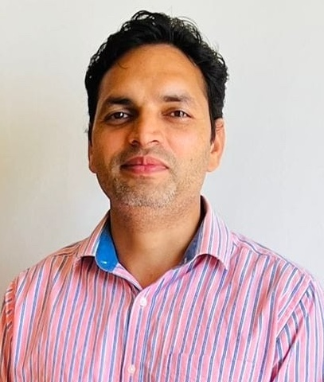
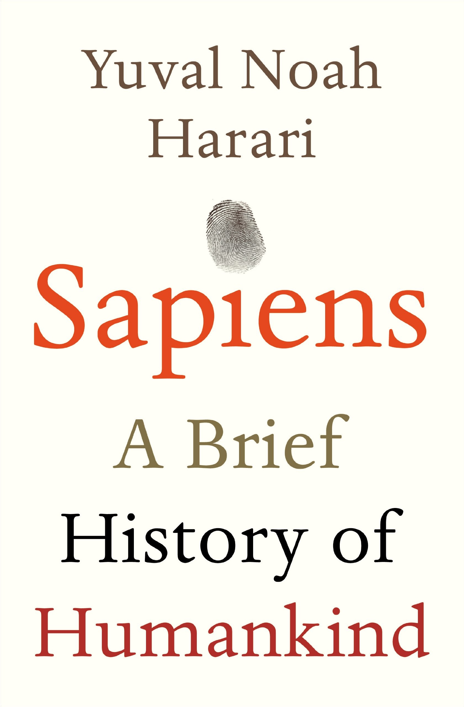
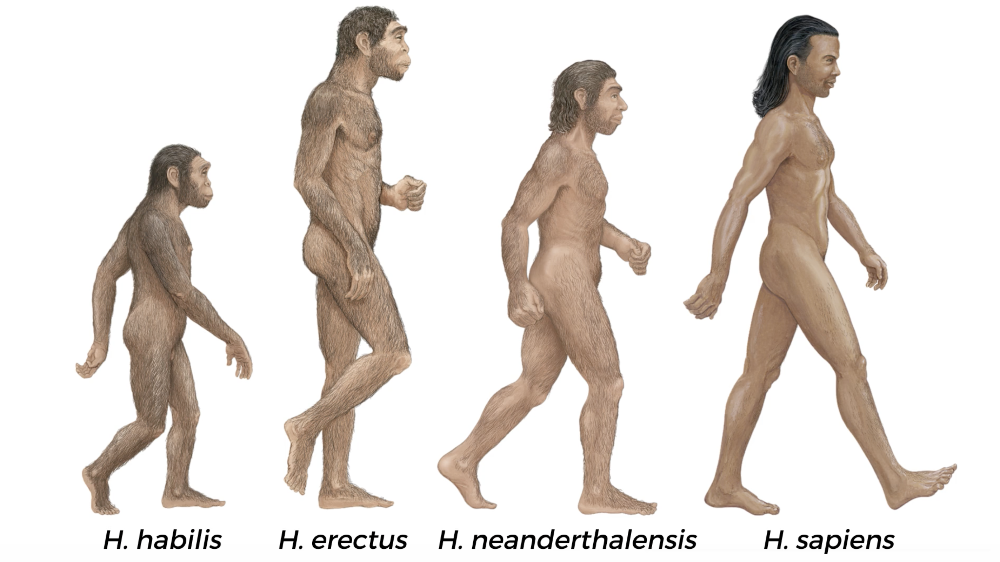

## Welcome {.centering}

:::: {.layout-grid}

::: {.col}
::: {.card}

### **Dr. Ajay Koli** $\cdot$ []()

Founder & Director &middot; SARA

:::
::: 

::: {.col}

:::

::: {.col}

::: 

::::

::: {.footer}
Title slide background image source: [krakograff](https://unsplash.com/photos/a-man-walking-down-a-street-next-to-a-wall-_ckTES3KFS4) on unsplash 
:::

# SARA Intro {background-image="images/sara-logo-medium.png" background-size="25%" background-position="80% 50%"}

## {.centering .center}

::: {.columns}

::: {.column width="35%"}

{fig-alt="Sara's headshot" fig-align="center" width=250px style="border-radius: 50%;"}

#### Savitribai Phule (1831-1897) 🪷🙏🏽🪷

:::

::: {.column width="20%"}

 

:::

::: {.column width="35%"}

{fig-alt="Sara's headshot" fig-align="center" width=250px style="border-radius: 50%;"}

#### Ramabai Ambedkar (1898-1935) 🪷🙏🏽🪷

:::

[**Savitribai Ramabai (SARA) Institute of Data Science, Sonipat**]{.r-fit-text}

:::

## About SARA

> Education for everyone

- Est. April 2023

- Free^[Students only pay for their food and accommodation.], open-source and inclusive education

## SARA Data Schools

> Non-profit events $\cdot$ Offline $\cdot$ Sonipat (HR)

1. SARA Summer School "R for Researchers"

1. SARA Winter School "Statistics using R"

1. SARA March Bootcamp "Publish using Quarto"

## Bridge Courses {background-image="images/youtube.jpeg" background-position="90% 50%" background-size="25%"}

> Free $\cdot$  Online $\cdot$ Open to all

::: {.nonincremental}

- Live on [SARA YouTube Channel](https://www.youtube.com/@SARADataScience)

- For first-generation parents & students.

- Essential subjects

:::

## Social Media {background-image="images/whatsapp.jpeg" background-position="right" background-size="contain"}

::: {.columns}

::: {.column width="50%"}

 
 

> WhatsApp Channel `+840`

::: aside

[](https://bsky.app/profile/sarainstitute.bsky.social) &nbsp; [](https://github.com/sara-edu) &nbsp; [](https://www.instagram.com/sara_data_sci/) &nbsp; [](https://twitter.com/sara_institute) &nbsp; [](https://www.facebook.com/profile.php?id=61564043738390) &nbsp; [](https://www.youtube.com/@SARADataScience) &nbsp; [](https://www.linkedin.com/company/sara-institute/) &nbsp; [](https://whatsapp.com/channel/0029Va4r7rGLCoWycMwThl2J)

:::

:::

::: {.column}

:::

:::

## Donate to SARA {background-image="images/upi-sara.png" background-position="right" background-size="contain"}

::: {.columns}

::: {.column width="50%"}

 
 

::: {.r-fit-text}

- Account Name: SARA EDUCATION TRUST

- Account Number: `42920911856`

- Bank Name: STATE BANK OF INDIA

- IFSC Code: `SBIN0000721`

:::

:::

::: {.column}

:::

:::

## SARA Library {background-image="images/book-donation.png" background-position="right" background-size="contain"}

::: {.columns}

::: {.column}
> 40 Books for Bridge Course Level 1

 

Link: <https://sara-edu.netlify.app/book-club/books-donation/sara_book_donations>

:::

::: {.column}

:::

:::

## Contact SARA {background-image="images/sara-logo-medium.png" background-size="20%" background-position="90% 50%"}

::: {.columns }

::: {.column width="70%"}
::: {.r-fit-text}
** Address:** 
SARA Institute   
Dr. Ambedkar Bhavan      
Near Dayanand Hospital            
Kakroi Road, Sonipat        
Haryana - 131001, India       
Google Map Link: <https://maps.app.goo.gl/d9S6a3pEFNXhnJGN6>

 

** Phone:** +91 925 315 2024 

** Email:** [sara.institute.info@gmail.com](mailto:sara.institute.info@gmail.com)

** Website:** <https://sara-edu.netlify.app/>

:::
:::

::: {.column width="25%" .center}

:::

:::

# Basic History {background-image="images/sapiens.jpg" background-size="contain" background-position="right"}

## About Author {background-image="https://pbs.twimg.com/profile_images/1034789978444886017/9GqAdkNk_400x400.jpg" background-position="85% 50%" background-size="30%"}

> Yuval Noah Harari

::: {.columns}

::: {.column}

- PhD from the University of Oxford

- His books sold 55 million copies in 65 languages

:::

::: {.column}

:::

:::

::: {.footer}

Image source: X [Yuval Noah Harari](https://x.com/harari_yuval) 

:::

# The Timeline of History

## The Timeline of History

> 13.8 billion years ago

Matter and energy appear. Beginning of physics. Formation of atoms and molecules. Beginning of chemistry.

## The Timeline of History

> 4.5 billion years ago

Formation of planet Earth.

## The Timeline of History

> 3.8 billion years ago

Emergence of organisms. Beginning of biology.

## The Timeline of History

> 6 million years ago

Last common grandmother of humans and chimpanzees.

## The Timeline of History

> 2.5 million years ago

Humans evolve in Africa. Ue of stone tools.

## The Timeline of History

> 2 million years ago

Humans spread from Africa to Eurasia. Evolution of different human species.

## The Timeline of History

> 4,00,000 years ago

Neanderthals evolve in Europe and the Middle East. Regular use of fire.

. . .

> 3,00,000

*Homo sapiens* evolves in Africa

## [Neanderthals "cousin" of Homo sapiens]{.r-fit-text} {background-color=black}

{fig-align="center"}

::: {.footer}
Source: Screenshot of video from [Britannica Digital Studios](https://www.britannica.com/topic/Neanderthal) 
:::

## The Timeline of History

> 70,000 years ago

The Cognitive Revolution. Emergence of storytelling. Beginning of history. Sapiens spread out of Africa.

## The Timeline of History

> 50,000 years ago

Sapiens settle across Australia. Extinction of Australian megafauna.

::: {.footer}
Image source: [The Guardian](https://www.theguardian.com/science/2020/may/19/humans-australia-megafauna-to-extinction-climate-queensland)
:::

## The Timeline of History

> 30,000 years ago

Extinction of Neanderthals. *Homo sapiens* the only surviving human species.

. . .

> 15,000 years ago

Sapiens spread across Americas. Extinction of American megafauna.

## The Timeline of History

> 12,000 years ago

The Agricultural Revolution. Domestication of plants and animals. Permanent settlements.

## The Timeline of History

> 5,000 years ago

First kingdoms, script and money. Polytheistic religions.

## The Timeline of History

> 4250 years ago

First empire - the Akkadian^[Central part of Iraq] Empire of Sargon^[Ruler of Mesopotamia]

## The Timeline of History {background-image="images/buddha.png" background-position="right" background-size="contain"}

> 2500 years ago

::: {.columns}

::: {.column}

- Invention of coins - a universal money.

- The Persian Empire - a universal political order.

- Buddhism in India - a universal teaching. 

:::

::: {.column}

:::

:::

::: {.footer}
Image source: [Encyclopedia Britannica](https://www.britannica.com/topic/Buddhism)
:::

## The Timeline of History

> 2000 years ago

Han Empire in China. Roman Empire in the Mediterranean. Christianity.

. . .

> 1400 year ago

Islam

## The Timeline of History 

> 500 years ago

- The Scientific Revolution

- Humankind admits its ignorance and begins to acquire unprecedented power.

- Europeans begin to conquer America and the oceans.

- The entire planet becomes a single historical arena. 

- The rise of capitalism.

## The Timeline of History 

> 200 years ago

- The Industrial Revolution.

- Family and community are replaced by state and market.

- Massive extinction of plants and animals.

## The Present

- Humans transcend the boundaries of planet Earth. 

- Nuclear weapons threaten the survival of humankind.

- Organisms are increasingly shaped by intelligent design rather than natural selection.

# Part One{background-image="https://nelliecole.com/wp-content/uploads/2020/05/1.jpg?w=2000&h=" background-position="90% 50%" background-size="30%"}

> The COGNITIVE REVOLUTION

::: {.notes}
30,000 years ago, on the wall of the Chauvet-Pont-d'Arc Cave in southern France.
:::

::: {.footer}
Image source: [Nellie Cole](https://nelliecole.com/2020/05/29/folkdays-cave-art/)
:::

